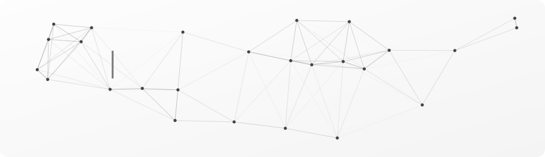

  

  

## 🧑‍💻 About me

* 🎓 Fourth-year student at the Faculty of Computers and Information, Arish University
* 💻 I enjoy building fast, user-friendly interfaces with clean, reusable components
* 🌱 Currently learning back-end development with Node.js, Express and MongoDB to become a MERN Stack developer

## 🤝 Let's Connect

## 🛠️ Tech Stack

  

  

## 📊 GitHub Stats

  
  

  
  

## 🔥 GitHub Streak

  

  Thanks for visiting. Feel free to explore my repositories. ⭐

